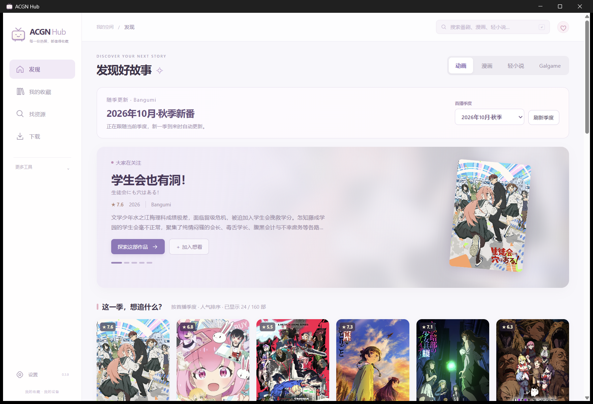
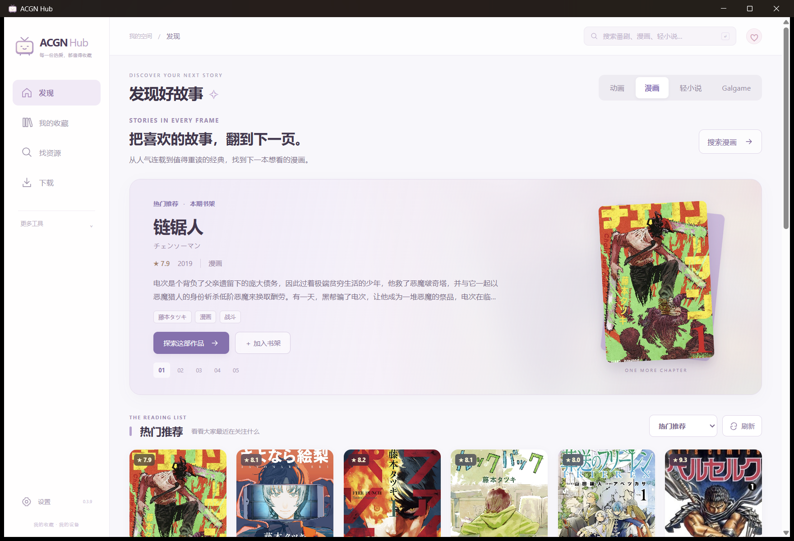
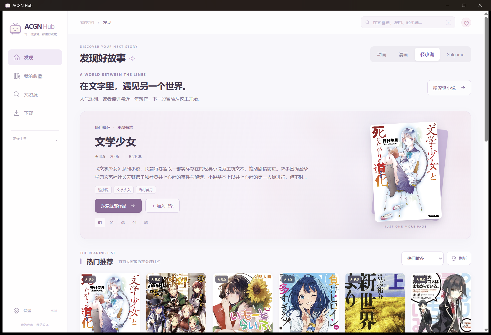
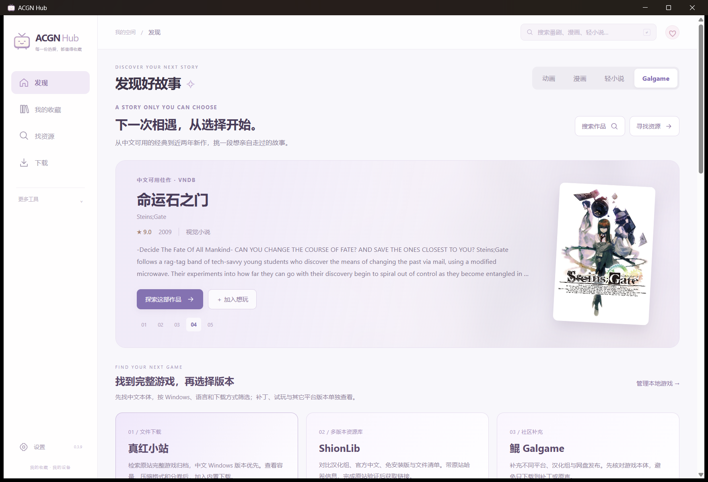
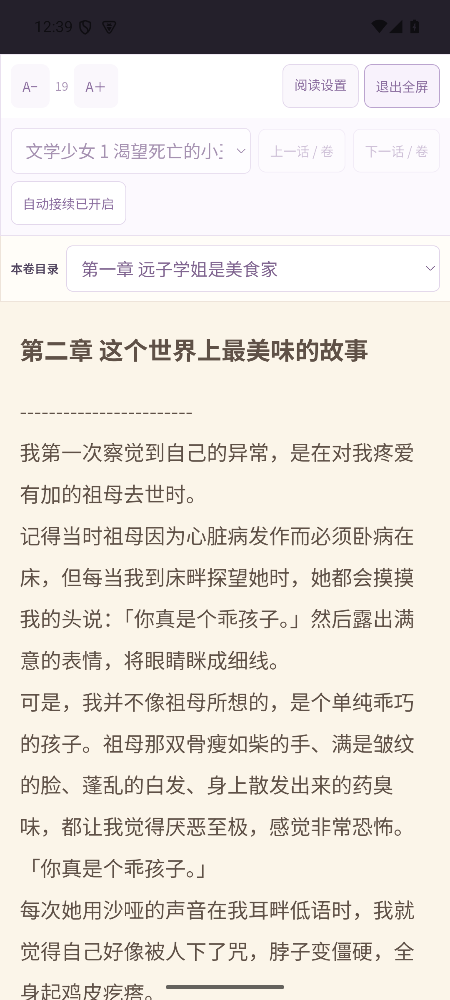

# ACGN Hub

为喜欢的故事留一个位置。面向 Windows 与 Android 的动画、漫画、轻小说与 Galgame 收藏工作台，将作品发现、资源检索、下载整理和离线阅读放在一起。

**[下载已发布版本](https://github.com/CidneyAurum/ACGN-Hub/releases/latest)** · [0.5.2 使用指南](docs/releases/v0.5.2-usage.md) · [English](README.en.md)

**0.5.2 本地验收和打包完成，待 GitHub 发布回验**，改进资源选择、收藏 / 来源初始化、Android任务恢复与JSON生命周期；见[指南](docs/releases/v0.5.2-usage.md)。已发布的 [0.5.1](https://github.com/CidneyAurum/ACGN-Hub/releases/tag/v0.5.1) 继续可用，本版不重构网络出口或处理节点限制。

## 发现、收藏，再慢慢看

- **跟随季度的番剧首页**：按本地年月切换 1 / 4 / 7 / 10 月新番，支持往季、放送表与分页。漫画、轻小说和 Galgame 也有独立封面书架。
- **作品与作者一起搜**：输入作品名或作者名，直接查看相关作品。Bangumi 与 VNDB 提供作品资料；资源检索可以独立使用。
- **清楚的资源选择**：显示来源、语言、平台、版本与获取方式，区分本体、补丁、试玩、原声、网页入口和文件直链。
- **下载与整理**：Windows 内置 aria2 处理 HTTP / HTTPS、磁力和 Torrent，qBittorrent 可选。Android 使用独立的前台 HTTP 下载引擎，漫画与小说沿用 CBZ / TXT 下载流程。两端按各自支持的资源类型提供操作。
- **下载后在应用内看**：CBZ 漫画支持长条滚动、单页与全屏；TXT 小说支持目录、字号、行距和纸色；保存进度，并可接续同作品已下载的下一话、卷或集。
- **带着收藏搬家**：Windows 便携包将资料保存在自己的 `Data` 中。关闭程序后移动完整目录，内部已登记路径和阅读进度随新位置更新。Android 使用应用私有目录，两个平台的资料库独立保存。

暖粉紫电视图标与真实作品封面贯穿界面；没有生成的 AI 角色素材。

## 界面预览

以下四图为 v0.3.9 正式桌面程序的真实界面，使用独立资料库及公开作品资料。后续版本延续这一视觉方向；这些图片不代表 Android 实机验收。

| 动画 · 季度发现 | 漫画 · 封面书架 |
| --- | --- |
|  |  |
| 轻小说 · 作品发现 | Galgame · 作品发现 |
|  |  |

下方为最终 v0.5.0 APK 在独立 **Android API 35 模拟器**中的真实截图，使用公开作品资料及隔离资料库。

| Android · 轻小说书架 | Android · 内置阅读 |
| --- | --- |
|  |  |

## 下载与首次启动

在 [Releases](https://github.com/CidneyAurum/ACGN-Hub/releases/latest) 下载 **Windows x64 便携 ZIP**，完整解压到可写目录后运行 `START-PORTABLE.cmd`。便携目录中的 EXE 也会通过 `ACGN-HUB-PORTABLE` 标记使用同一个 `Data`。不要从压缩包预览窗口直接运行，也不要只取走 EXE。

需要 Microsoft Edge WebView2 Runtime；普通使用无需安装 Node.js、Rust 或独立 aria2。NSIS 安装包作为另一种分发方式提供。Windows 发布架构为 x64。

首次使用只需三步：

1. 在「设置」确认待整理、作品库和电子书输出目录。
2. 到「来源管理」启用需要的来源；预置下载来源默认关闭。
3. 从发现页打开作品，或在「找资源」直接搜索，再选择准确的作品版本和章节。

Windows 普通直链和 BT 下载使用内置引擎。JMComic、公开投稿等可选功能需要相应本机工具，详情见[使用指南](docs/releases/v0.5.0-usage.md)。发行包不含账号、用户资料或作品文件。

## 0.5.0：同一套书架，适配电脑与手机

Android APK 包含 **arm64-v8a 与 x86_64**，最低为 **Android 8.0 / API 26**。安装后通过底部导航进入书架、资源和下载；更多工具从菜单打开。漫画支持触屏翻页及横竖屏阅读，完成的文件可调用系统「导出 / 分享」选择器。

| 能力 | Windows x64 | Android |
| --- | --- | --- |
| 作品发现、搜索、收藏 | 支持 | 支持 |
| 普通 HTTP 文件下载 | 内置 aria2 | 原生前台引擎，已实测暂停 / 续传与重启恢复 |
| 漫画 CBZ、小说 TXT 下载与内置阅读 | 支持 | 支持，触屏翻页与阅读进度保留 |
| 磁力、Torrent、qBittorrent | 支持 | 不支持，操作入口提示需电脑版 |
| Python / JMComic / 公开投稿工具 | 需要相应本机工具 | 不支持 |
| Galgame 资源检索与文件下载 | 按来源获取 | 检索及普通 HTTP 归档下载 |
| Windows 游戏扫描、启动及存档工具 | 支持相应本地工具流程 | 不支持 |
| 便携目录迁移 | 完整 `Data` 随目录搬迁 | 应用私有目录，不使用 Windows 便携模式 |

Android 下载要求应用保持运行。原生 HTTP 任务保存断点，重启后恢复为暂停；续传取决于服务器支持。当前没有系统后台下载服务，不承诺锁屏或后台持续传输。CBZ / TXT 可在应用内阅读；本地视频播放取决于 Android WebView 及系统编码。两个平台的资料库独立保存，暂不自动同步。具体已验证样本与设备范围见[构建和验证记录](docs/research/android-v050.md)。

## 0.4.0：补齐轻小说与 Galgame，改善便携使用

轻小说继续以 **LNovel 中文日轻文本**为主，改善标题与作者匹配、正文实体解码、插图条目识别和资源 ID 校验。可通过作品链接或站点 ID 补查缓存目录外的作品，能否取得仍取决于上游；TXT 为纯文本，不含原书插图。

轻小说首页先显示首批 8 部真实推荐，再补齐本页 24 部；已有缓存过期也会先显示并后台更新。后续请求失败时保留已有结果，可用「补全本页」继续加载。

LNovel 缓存漏掉正篇时，会补查官方月 / 周索引。《无职转生》正篇 2013 与蛇足篇 4325 分别展示；0.4.0 核查时正篇详情返回 HTTP 408、首章已下架，未取得完整卷，不能据此承诺当前可下载。见[正篇核查记录](docs/research/lnovel-main-series-v040.md)。

Galgame 扩展真红小站原文合集文件目录，保留中文 Windows 版本优先；改善 KUN、ShionLib 与官方发行入口的作品匹配、分页及取消处理。资源语言依据来源信息标记，原文合集不会自动当作中文版。

便携包新增独立模式标记，修复 EXE 与启动脚本使用不同资料库、移动后绝对路径失效，以及输出发布依赖 NTFS 硬链接的问题。迁移在启动下载前完成；异常时保留记录，活动的内置下载任务暂停待确认续传。

## 各来源能提供什么

| 用途 | 来源 | 实际能力 |
| --- | --- | --- |
| 作品资料 | Bangumi、VNDB | 封面、简介、评分、作者关系、季度或发行目录；不等于媒体下载源 |
| 动画 | 蜜柑、AcgnX、自定义 RSS | 种子、磁力或源中提供的链接；BT 速度取决于实际节点与网络 |
| 中文漫画 | MangaBZ、拷贝漫画 | 可读取的章节原图生成 CBZ；访问条件以原站为准 |
| 漫画补充 | MangaDex | 多语言章节原图；是否有中文取决于所选章节 |
| 日轻中文文本 | LNovel | 来源可公开读取的分卷生成 TXT；不含插图 |
| Galgame 文件 | 真红小站 | 中文目录及原文合集中的文件直链，保留版本和分卷信息 |
| Galgame 多版本目录 | ShionLib | 版本、平台、文件与哈希信息；获取实际链接可能需要原站验证 |
| Galgame 补充 | KUN、VNDB 官方发行 | 社区分享入口、官方商店、试玩及免费发行参考；网页入口由浏览器打开 |
| 其它可选来源 | Internet Archive、公开投稿等 | 按各自内容和访问条件使用；不保证覆盖特定作品 |

来源健康检查只确认当前接口或目录可访问，不代表每个文件均可完整下载。实际可用内容、语言与版本以原站和所选资源为准。WeebCentral、快看已撤下。

## 便携、迁移与升级

```text
ACGN-Hub/
├─ ACGN-Hub-<版本>.exe
├─ START-PORTABLE.cmd
├─ ACGN-HUB-PORTABLE
└─ Data/                       首次启动后创建
   ├─ acgn-hub.db               收藏、资源与下载记录
   ├─ WebView2/                设置、阅读进度及界面资料
   └─ Files/                   默认下载、书库与存档备份
```

**迁移**：完全退出程序，复制整个便携目录到新位置或另一台 Windows x64 电脑，再启动。`Data` 内已登记路径自动更新；外部自定义媒体目录保留原路径，需要自行搬迁或重新设置。连接凭据和第三方登录可能需要重新填写。

**升级**：先关闭程序并备份旧目录，将新版解压到独立目录，再把原 `Data` 复制到新版目录后启动。已有目标 `Data` 时先保留它，不合并覆盖两个资料库。旧版未记录便携位置时，仅在多个默认目录一致的情况下自动识别旧路径；升级后请核对保存位置。不要让两个实例同时写同一个 `Data`。

便携支持 NTFS，并使用兼容 exFAT / FAT32 的无覆盖发布方式；真实 exFAT 设备尚未验证，FAT32 仍有单文件 4 GiB 限制。未完成的改名恢复需先在原位置处理。完整步骤见[迁移与升级指南](docs/releases/v0.4.0-usage.md#迁移与升级)。

## 开发

前端使用 Vue 3、TypeScript、Vite；原生端使用 Tauri 2、Rust、SQLite，Android 封装使用 Gradle / Kotlin。使用支持当前 Vite 版本的 Node.js LTS。Windows 桌面构建另需 Rust MSVC 工具链、Visual Studio C++ Build Tools 与 Windows SDK。

```powershell
npm ci
npm run dev
```

浏览器开发模式用于界面预览；原生下载和本地文件访问需要对应平台的原生程序。

```powershell
npm run verify
npm run test:e2e
powershell -NoProfile -File .\src-tauri\scripts\build-desktop.ps1 -Action test
```

构建桌面程序及 NSIS 安装包：

```powershell
powershell -NoProfile -File .\src-tauri\scripts\build-desktop.ps1 -Action bundle
```

构建脚本会检查前端、Cargo 与 Tauri 版本是否一致，并加载本机 MSVC / SDK。正式包装脚本额外要求匹配的静态扫描证据；`release/`、`.work/`、用户数据库与媒体不上传 Git。

Android 构建另需 JDK 17、Android SDK / NDK 与对应 Rust 目标。Windows 主机构建仍需上述 MSVC 工具。设置 `JAVA_HOME`、`ANDROID_HOME` 与 `NDK_HOME` 后运行：

```powershell
powershell -NoProfile -File .\src-tauri\scripts\build-android.ps1 -Action info
powershell -NoProfile -File .\src-tauri\scripts\build-android.ps1 -Action build
```

默认构建 arm64 与 x86_64，使用校验后复制原生库的方式封装，无需为此改变 Windows 符号链接权限。正式安装包仍需签名；工具版本与签名步骤见[0.5.0 指南](docs/releases/v0.5.0-usage.md#开发构建)。私钥、口令、用户数据和构建缓存不进入仓库。

## 验证与文档

0.5.2通过 **743单测、102完整浏览器、118 Rust**（2默认忽略）及类型检查。最终Windows实测TXT / CBZ内读与已有进度；API35 Android升级保留收藏和来源，真实LNovel候选改词失效、20卷详情、新卷1下载 / 内读 / 选择器取消通过。原9表、3媒体、26旧EXE保持，最终交付待回验。身份与未覆盖范围见[验证记录](VERIFICATION.md)；完整Galgame安装运行未验收，EPUB / PDF使用外部阅读器。

| 文档 | 内容 |
| --- | --- |
| [0.5.2 使用指南](docs/releases/v0.5.2-usage.md) | 资源选择、初始化、任务恢复及请求生命周期修复 |
| [0.5.2 修复记录](docs/research/bugfixes-v052.md) | 确定复现、回归及本版构建和原生范围 |
| [0.5.1 使用指南](docs/releases/v0.5.1-usage.md) | 兼容补丁、升级与 Android 来源失败排查 |
| [0.5.1 修复记录](docs/research/bugfixes-v051.md) | 确定复现、修复前后测试及手机网络诊断边界 |
| [0.5.0 使用指南](docs/releases/v0.5.0-usage.md) | Windows / Android 安装、下载、手机存储、阅读与开发构建 |
| [Android 构建与验证](docs/research/android-v050.md) | 双架构 APK 身份、签名、实际设备样本与验证边界 |
| [0.4.0 使用指南](docs/releases/v0.4.0-usage.md) | 已发布 Windows 版本的首次启动、来源选择、阅读与便携升级 |
| [验证记录](VERIFICATION.md) | 各版本实际测试与未覆盖边界 |
| [历史 README](HISTORY.md) | 原 README 完整存档，保留历史交付叙述与当时路径 |
| [本地阅读研究](docs/research/local-reader-references-v036.md) | 阅读交互参考与实现范围 |
| [轻小说正篇核查](docs/research/lnovel-main-series-v040.md) | 缓存漏检修复、《无职转生》正篇与正文限制 |
| [Galgame 文件来源](docs/research/galgame-direct-source-v038.md) | 直链及部分传输的历史核验 |
| [第三方声明](THIRD_PARTY_NOTICES.md) | 依赖、内置 aria2、作品内容与素材归属 |

封面、文本和其它作品内容属于各自权利人。仓库公开源码不改变第三方内容或依赖的许可；本项目尚未单独指定项目许可证。
